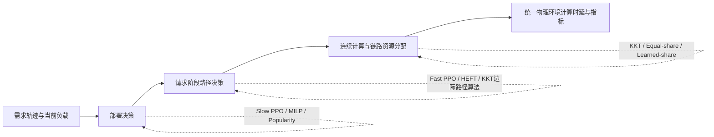

# 对比方案设计

> 2026-10-15 更新：DARP、DPMS 保留名称，但当前默认实现改为 `demand-greedy-v2`。新定义、公式、限制与复现选项见 [DARP/DPMS v2](docs/DARP_DPMS_V2.md)。下文 MILP/整链调度部分属于 `legacy-v1` 历史设计，不能用来描述 v2；历史结果不变。Proposed、MSO、HEFT、Hybrid 本次未改。

> 归档状态：UnifiedPPO 已按当前实验决策标记为失败算法对比尝试，尚无完成的同预算正式五场景结果；见 `docs/FAILED_UNIFIED_PPO_COMPARISON.md`。下文 UnifiedPPO 部分保留其实现设计，不表示论文结果已经成立。

## 1. 文档目的与适用版本

本文档说明项目代码支持的全部十一个方案、最近一次实验采用的五个主方案，以及一组独立的 KKT 连续资源分配对照。下列 checkpoint 和结果目录记录该次实验的历史来源；`results/final` 中复制的对比结果已按本节新名称重新标注并绘图，数值未改变：

- 对比运行时的代码版本：`7cfad49`，分支 `codex/monolithic-v4-refactor`；
- Proposed checkpoint：`runs/slow_stage_credit_v2_s6_u320_20261001_235825/checkpoints/best.pt`；
- MSO checkpoint：`runs/monolithic_v4_refactor_s6_u320_20261005_002041/checkpoints/best.pt`；
- 五方案结果目录：`results/comparison/five_schemes_v4_s6_seed2026_20261005_135015`。

当前方案名称与历史标识的对应关系如下；新实验命令使用右侧缩写，输出表与图例使用英文全称。

| 历史标识 | 当前标识 | 英文全称 |
|---|---|---|
| Monolithic | MSO | Monolithic Service Orchestration (MSO) |
| Algorithmic | DPMS | Demand-Aware Placement and Marginal-Cost Scheduling (DPMS) |
| HEFTFast | HEFT | Heterogeneous Earliest Finish Time Scheduling (HEFT) |
| PopularityDeploy | DARP | Demand-Aware Replica Placement (DARP) |

最近一次已完成的主实验包含以下五个方案：

1. **Proposed**：Slow PPO 分阶段部署 + Fast PPO 分阶段调度 + KKT 连续资源分配；
2. **MSO**：Slow PPO 完整服务部署 + Fast PPO 完整服务调度 + KKT 连续资源分配；
3. **DPMS**：需求感知 MILP 部署 + 因果 KKT 边际代价路径算法 + KKT 连续资源分配；
4. **HEFT**：Proposed Slow PPO 部署 + HEFT-style 调度 + KKT 连续资源分配；
5. **DARP**：热度/容量/局部性算法部署 + Proposed Fast PPO 调度 + KKT 连续资源分配。

代码还保留以下六个可选对照，用于更细的组件分析；它们没有混入上述最近一次五方案结果：

6. **Hybrid**：Proposed Slow PPO 部署 + 因果 KKT 边际代价路径算法；
7. **PopularityEFT**：热度/容量/局部性算法部署 + 在线最早完成时间调度；
8. **PopularityNearest**：热度/容量/局部性算法部署 + 最近可达副本调度；
9. **FitDeploy**：需求优先 First-Fit 部署 + Proposed Fast PPO；
10. **UniformFirstFitDeploy**：需求无关的均匀 First-Fit 部署 + Proposed Fast PPO。
11. **UnifiedPPO**：一个共享 PPO 同时学习阶段部署、逐请求逐阶段路由和资源优先级，不使用 KKT 优化器。

`run_comparison.py` 当前 `FORMAL_SCHEMES` 默认值是 `Proposed MSO Hybrid DPMS`；历史运行时的对应旧标识为 `Proposed Monolithic Hybrid Algorithmic`。这只是命令行默认集合。最近一次论文候选结果显式选择的是前述五个主方案，二者不可混写。

此外，独立运行以下资源分配对照：

- `Proposed`：计算与链路均使用 KKT；
- `NoKKT-Compute`：计算等分，链路使用 KKT；
- `NoKKT-Link`：计算使用 KKT，链路等分；
- `NoKKT-All`：计算与链路均等分。

这里的“完整服务部署”指一个服务的所有阶段必须共同部署到同一节点，并不是删除服务内部计算量。MSO 会将各阶段计算、内存和存储需求聚合成一个整体。

---

## 2. 对比实验要回答的问题

| 对比 | 保持不变的部分 | 替换的部分 | 回答的问题 |
|---|---|---|---|
| Proposed vs. MSO | 双时间尺度 PPO、物理网络、需求轨迹、KKT 结算 | 分阶段服务表示改为完整服务表示 | 分阶段部署和分阶段执行路径是否有价值？ |
| Proposed vs. DPMS | 物理环境、需求轨迹、KKT 结算 | Slow 与 Fast 都改为确定性优化/算法 | 双智能体 DRL 是否优于完整的模型驱动方案？ |
| Proposed vs. HEFT | Slow PPO 部署、物理环境、KKT 结算 | Fast PPO 改为 HEFT-style 调度 | 学习式 Fast 调度是否优于经典异构列表调度？ |
| Proposed vs. DARP | Fast PPO、物理环境、KKT 结算 | Slow PPO 改为固定部署算法 | 学习式 Slow 部署是否具有独立贡献？ |
| Proposed vs. Hybrid | Slow PPO 部署、物理环境、KKT 结算 | Fast PPO 改为因果 KKT 路径算法 | 在相同学习式部署下，Fast PPO 是否优于模型驱动选路？ |
| PopularityEFT vs. DPMS | KKT 结算与物理环境 | 较简化的部署和逐阶段 EFT 调度 | 完整链路边际建模相对局部贪心有何价值？ |
| PopularityNearest vs. PopularityEFT | 同一个 PopularityPlacement | Fast 改为只看传播距离的最近副本规则 | 计算、数据量和动态负载信息是否必要？ |
| Proposed vs. FitDeploy | Fast PPO、物理环境、KKT 结算 | Slow 改为需求排序 First-Fit | 学习部署相对简单需求贪心装箱的贡献是什么？ |
| FitDeploy vs. UniformFirstFitDeploy | First-Fit 节点顺序、覆盖修复、Fast PPO、KKT | 副本优先级是否读取需求 | 需求热度信息对部署本身贡献多少？ |
| KKT vs. NoKKT | 部署动作、完整调度路径、需求轨迹、物理环境 | 仅改变连续计算/带宽分配规则 | KKT 连续资源分配本身贡献了多少？ |
| Proposed vs. UnifiedPPO | 物理网络、需求分布、训练时长、PPO 算法族 | 双时间尺度分解与解析 KKT 改为单一端到端 PPO | 分层决策、信用分解和 KKT 模块是否共同改善样本效率与最终性能？ |

各方案的三层结构如下：

| 方案 | 服务部署层 | 请求调度层 | 连续资源分配层 | 是否需要训练 |
|---|---|---|---|---|
| Proposed | Slow PPO | Fast PPO | KKT | 是 |
| MSO | MSO Slow PPO | MSO Fast PPO | KKT | 是，独立训练 |
| DPMS | 需求感知 MILP + 边际副本扩展 | 因果 KKT 边际代价动态规划 | KKT | 否 |
| HEFT | 冻结的 Proposed Slow PPO | HEFT-style 列表调度 | KKT | 不额外训练 |
| DARP | 热度/容量/局部性部署算法 | 冻结的 Proposed Fast PPO | KKT | 不额外训练 |
| Hybrid | 冻结的 Proposed Slow PPO | 因果 KKT 边际代价动态规划 | KKT | 不额外训练 |
| PopularityEFT | 热度/容量/局部性部署算法 | 在线逐阶段 EFT 贪心 | KKT | 否 |
| PopularityNearest | 热度/容量/局部性部署算法 | 最近可达副本 | KKT | 否 |
| FitDeploy | 需求优先 First-Fit | 冻结的 Proposed Fast PPO | KKT | 不额外训练 |
| UniformFirstFitDeploy | 均匀 First-Fit | 冻结的 Proposed Fast PPO | KKT | 不额外训练 |
| UnifiedPPO | 共享 PPO | 同一个共享 PPO | PPO 优先级 + learned-share 容量归一化 | 是，独立训练 |
| KKT 独立对照 | 冻结 Proposed 动作 | 冻结 Proposed 动作 | KKT 或等分 | 否 |



---

## 3. 统一物理环境与需求设置

### 3.1 基础环境

| 参数 | 当前值 | 含义 |
|---|---:|---|
| 用户数 | 12,000 | 城市区域内的潜在用户 |
| 边缘节点数 | 32 | 可部署和执行任务的节点 |
| 服务类型数 | 10 | 10 类 Edge-AI 流水线服务 |
| 单服务阶段数 | 2–3 | 串行处理阶段 |
| Episode 时长 | 60 分钟 | 每个评估轨迹的逻辑时长 |
| 部署周期 | 10 分钟 | Slow 层每个 episode 决策 6 次 |
| 无线速率 | 150 Mbps | 用户到接入边缘的上行速率 |
| 无线 RTT | 10 ms | 接入侧固定往返延迟参数 |
| 拓扑 | 对称连通 6 近邻图 | 阶段间传输经过真实多跳路径 |
| 有线带宽缩放 | 0.75 | 对基础有线链路能力的缩放 |
| 服务资源份额 | 0.60 | 每个节点可供本系统使用的内存/存储比例 |
| 节点负载 EWMA 时间常数 | 1 分钟 | 历史负载对有效容量的影响速度 |
| 到期时间缩放 | 2.75 | Edge-AI 服务 deadline 的统一缩放 |

物理节点采用 `hardware-constrained` 配置，节点类型由以下三类设备构成：

| 节点类型 | 抽样概率 | 基准内存 | 基准存储 | 有效计算能力 | 网络上行 |
|---|---:|---:|---:|---:|---:|
| Raspberry Pi 5 类 | 45% | 8 GB | 128 GB | 38.4 Gcycles/s | 125 MB/s |
| Jetson Orin Nano 类 | 40% | 8 GB | 256 GB | 72 Gcycles/s | 125 MB/s |
| PowerEdge XR4000 类 | 15% | 128 GB | 1,920 GB | 168 Gcycles/s | 1,250 MB/s |

节点的内存、存储和计算能力还会施加代码中给定的小幅随机扰动。拓扑不是全连接网络；每条逻辑传输会沿最短可达物理路径经过一条或多条链路，并累计每条链路上的带宽竞争和传播时延。

### 3.2 服务负载

服务采用 `edge-ai-pipelines` 配置，包括语音识别、AR 叠加、视频目标检测、工业检测、交通感知、智能零售事件、机器人控制、医疗生命体征异常检测、无人机检测和车联网规划等十类任务。

每个请求包含：

- 用户接入节点与服务类型；
- 请求聚合数量 `request_count`；
- 输入数据量；
- 各阶段计算量；
- 各阶段输出数据量；
- 服务时延约束。

阶段按照串行因果顺序执行。环境按阶段相位分别结算：相同阶段相位上的不同请求可以并发竞争资源，但一个请求的前后阶段不会被错误地放进同一个并行 KKT 问题。

### 3.3 有效容量

当前节点和链路负载会减少本次结算可用容量：

\[
C_n^{\mathrm{eff}}=C_n\,\mathrm{clip}(1-0.75L_n,\,0.10,\,1),
\]

\[
B_{uv}^{\mathrm{eff}}=B_{uv}\,\mathrm{clip}(1-0.75L_{uv},\,0.10,\,1).
\]

其中，\(L_n\) 和 \(L_{uv}\) 分别为节点和链路的历史负载。所有主方案使用完全相同的容量计算方式。

---

## 4. Proposed：双智能体分阶段 DRL

### 4.1 总体结构

Proposed 是本文方法，采用两个时间尺度不同、但同时收集轨迹并联合更新的 PPO 控制器：

- **Slow PPO**：每 10 分钟决定服务阶段副本数量及放置节点；
- **Fast PPO**：每个请求批次内，为每个服务阶段依次选择执行节点；
- **KKT 模块**：在路径确定后，联合计算同一秒内请求的计算资源与链路带宽份额。

Slow 与 Fast 不直接输出 CPU 频率或带宽比例。这些连续变量由 KKT 模块解析求解，从而缩小 PPO 动作空间并保证资源约束。

### 4.2 Slow Count 与 Placement

当前 Slow 使用 `budget-continuous-v2`：

1. Count 根据需求、上一窗口反馈、可用资源和当前部署，确定整体副本预算；
2. Placement 在内存、存储、已有副本和可部署掩码约束下，逐个选择节点；
3. 每个有效服务阶段至少部署一个副本；
4. 重复节点被掩码禁止，同一阶段在同一节点上最多一个副本。

Slow 状态包括节点能力、节点负载、链路情况、服务需求、当前部署，以及上一窗口的平均/P95时延、违约率、无效动作率、资源使用率等反馈。

Slow 的信用由三部分组成：

- 窗口级系统回报：主要反映 10 分钟窗口内的平均时延和尾时延；
- Count 局部回报：阶段时延、短缺、deadline、冗余或未使用副本；
- Placement 局部回报：节点局部负载、实际流量使用、跨节点阶段传输与闲置情况。

独立窗口 critic 学习跨 6 个部署窗口的轨迹回报，并仅在留出集解释方差可靠时，将系统级残差注入 Count 和 Placement。每个窗口还抽取 2 个副本执行反事实移除测试，为副本数量提供局部因果信用。

### 4.3 Fast PPO

Fast 使用 `gat_node_scorer`，对可部署节点进行图注意力编码和节点打分。每个阶段的动作掩码会排除：

- 未部署该服务阶段的节点；
- 从上一阶段不可达的节点；
- 其他违反环境可行性约束的动作。

Fast 状态包含：

- 候选节点计算能力与当前负载；
- 物理路径带宽、传播时延和当前链路负载；
- 当前阶段计算量、输入或中间数据量；
- 当前批次已经形成的 KKT 平方根负载账本；
- 候选动作的预计 KKT 边际代价。

训练时 Fast 使用因果 KKT 增量奖励。一个动作引起的增量总代价为当前资源平方根账本加入该阶段需求前后的 KKT 目标差，奖励取负值并乘以 `reward_scale=10`。不可由 Fast 控制的无线接入时延不作为路径选择信用。

在当前 `chain-kkt-v3` 路径下，Fast 每完成一个阶段动作就立即把该阶段的计算与链路工作加入虚拟 KKT 账本；完成整条请求链后再处理下一请求。因此后续动作能够看到批内先前动作造成的资源竞争。checkpoint 中仍保存 `fast_reservation_microbatch_size=16`，但该字段只作用于旧的 `legacy/chain-v2` 调度分支，不改变 `chain-kkt-v3` 的逐阶段、逐请求因果记账。环境最终仍对整秒请求执行权威的联合 KKT 结算。

### 4.4 Proposed 训练参数

| 参数 | 值 |
|---|---:|
| 训练设计 | `trajectory-simultaneous` |
| 更新次数 | 320 |
| Episode 数 | 640 |
| Rollout/部署窗口数 | 3,840 |
| 每个 update | 2 个 60 分钟 episode，共 12 个窗口 |
| 训练抽样 | 每 10 分钟窗口 6 个结算秒 |
| Fast 学习率 | 0.0002 |
| Fast PPO epochs | 4 |
| Fast minibatch | 512 |
| Fast KL 阈值 | 0.015 |
| Fast 初始熵系数 | 0.001 |
| Fast 归一化熵目标/上限 | 0.18 / 0.02 |
| Slow Count 学习率 | 0.0001 |
| Slow Placement 学习率 | 0.0001 |
| Slow 基础 PPO epochs | 2 |
| Slow Placement epochs | 3 |
| Slow minibatch | 2,048 |
| Count/Placement KL 阈值 | 0.015 / 0.015 |
| Slow 窗口折扣因子 | 0.95 |
| Slow critic 学习率/epochs | 0.0005 / 8 |
| 副本消融样本 | 每窗口 2 个 |
| 负载分层 | `[0.65,0.80]`、`[0.80,1.00]`、`[1.00,1.20]`、`[1.20,1.45]` |
| 分层概率 | 0.20、0.45、0.25、0.10 |

---

## 5. MSO：完整服务双智能体 DRL

### 5.1 唯一的服务结构变化

对于原服务 \(s\) 的多个阶段，MSO 构造一个聚合阶段：

\[
c_s^{\mathrm{mono}}=\sum_j c_{s,j},\qquad
m_s^{\mathrm{mono}}=\sum_j m_{s,j},\qquad
z_s^{\mathrm{mono}}=\sum_j z_{s,j}.
\]

聚合阶段的中间输出量设为 0。Fast 只选择一个节点，该节点随后被投影为原物理环境中所有阶段的执行节点：

\[
(n_{s,1},n_{s,2},\ldots,n_{s,J})=(n_s,n_s,\ldots,n_s).
\]

因此：

- 服务总计算量、总内存和总存储没有消失；
- 服务内部不再产生跨节点中间传输；
- 一个节点必须同时容纳该服务的全部阶段资源；
- 同一个请求的所有阶段只能在同一节点执行。

### 5.2 V4 学习设计

MSO V4 仍是 Slow PPO + Fast PPO，并不是启发式算法。针对一阶段动作进行了以下必要适配：

1. **严格逐请求 KKT 预留**：显式配置的预留微批大小为 1；在实际使用的 `chain-kkt-v3` 路径中，每个阶段动作完成后立即更新虚拟账本；
2. **批内 Fast 轨迹**：同一结算秒内的请求形成一条连续 PPO 轨迹，只在该批最后一个请求处终止；
3. **剩余需求状态**：Fast 可观察尚未调度的服务、来源节点、计算量和数据量；
4. **Slow 状态连续性**：评估时保留上一个窗口的完整服务部署，并反馈上一窗口指标；
5. **负载分层与副本消融**：继承 Proposed 的分层权重，每窗口执行 2 次副本反事实采样；
6. **PPO 参数继承**：Fast 学习率、熵控制、KL 和 epochs 与 Proposed 一致，不再采用 V3 的温度策略。

### 5.3 训练参数与公平性说明

MSO 同样训练 320 updates、640 episodes 和 3,840 个窗口，使用相同的物理种子、需求随机流、负载分层、episode 长度和抽样数量。

主要差异如下：

| 参数 | Proposed | MSO V4 |
|---|---:|---:|
| 服务表示 | 2–3 个串行阶段 | 1 个聚合阶段 |
| Fast 动作 | 每阶段选择节点 | 每服务选择一个节点 |
| checkpoint 中的 Fast 预留微批字段 | 16 | 1 |
| `chain-kkt-v3` 实际账本更新 | 每阶段动作后立即更新 | 每阶段动作后立即更新（聚合服务仅 1 个阶段） |
| Fast 轨迹终点 | 每个请求的末阶段 | 每批请求的末请求 |
| Fast 学习率 | 0.0002 | 0.0002 |
| Fast epochs | 4 | 4 |
| Fast KL | 0.015 | 0.015 |
| Slow allocation | `budget-continuous-v2` | `budget-continuous-v2` |
| 允许充分占用资源 | 否 | 是 |

表中的预留微批字段是为了 checkpoint 兼容和旧调度分支而保留的配置项；当前两者均走 `chain-kkt-v3`，不能据此声称 Proposed 使用过期 16 请求状态而 MSO 使用逐请求状态。

本次 MSO 训练使用了 `--allow-full-resource-use`。因此当前实验中 MSO 与 Proposed 不仅存在阶段折叠差异，还存在部署奖励系数差异：

| Slow 奖励项 | Proposed | MSO V4 |
|---|---:|---:|
| 内存占用系数 | 0.03 | 0 |
| 存储占用系数 | 0.01 | 0 |
| 闲置副本系数 | 0.05 | 0.01 |
| Count 未使用副本系数 | 0.015 | 0.005 |
| Placement 闲置系数 | 0.02 | 0.005 |

硬内存和存储可行性约束仍然完全保留。论文中应将当前比较表述为“经过各自合理调优的分阶段与完整服务 DRL 方案比较”，不能表述为严格的单变量阶段折叠消融。如果需要证明纯粹的阶段结构贡献，应另训一份与 Proposed 奖励系数完全一致的 MSO checkpoint。

---

## 6. DPMS：MILP 部署与因果 KKT 路径算法

DPMS 不加载学习模型，部署和调度都由确定性算法给出。

### 6.1 第一步：强制覆盖 MILP

令 \(x_{sjn}\in\{0,1\}\) 表示服务 \(s\) 的阶段 \(j\) 是否部署在节点 \(n\)。MILP 首先为每个有效阶段选择且只选择一个强制副本：

\[
\sum_n x_{sjn}=1,\qquad \forall(s,j).
\]

节点内存和存储约束为：

\[
\sum_{s,j}m_{sj}x_{sjn}\le M_n,
\qquad
\sum_{s,j}z_{sj}x_{sjn}\le Z_n.
\]

线性目标综合以下估计：

- 用户服务权重形成的节点—服务需求；
- 需求加权的接入和中间传输成本；
- 当前负载修正后的节点计算能力；
- 阶段平均计算量、输入量和中间输出量。

MILP 使用 SciPy `milp`：

- 时间限制：5 秒；
- 相对 MIP gap：1%；
- 若没有可行解，则记录实验失败，不用其他算法静默替代。

### 6.2 第二步：边际副本扩展

在保证每阶段一个副本后，算法枚举所有满足内存/存储约束的附加副本。对候选副本计算：

\[
\mathrm{priority}=\frac{\text{加入副本后预测时延下降}}
{\text{内存占用比例}+\text{存储占用比例}}.
\]

预测代价包括串行服务路径、需求加权的网络传输、节点执行时延，以及与当前请求率相关的池化计算拥塞近似。每次加入优先级最高的正收益副本，并重新计算该服务的候选收益；直到没有正收益可行副本。默认不设置额外副本上限。

### 6.3 Fast：因果 KKT 边际代价动态规划

对于一个批次，算法按照请求在轨迹中的原顺序处理。每个串行阶段在已部署节点上做动态规划。若某资源已有平方根账本 \(S\)，新增需求量为 \(d\)、请求聚合数量为 \(m\)、有效容量为 \(C\)，其增量总代价为：

\[
\Delta J=\frac{(S+m\sqrt d)^2-S^2}{C}.
\]

路径代价包括：

- 候选节点上的计算 KKT 增量；
- 输入或阶段输出经过每条物理链路的 KKT 增量；
- 多跳路径传播时延。

选出完整串行路径后，算法立即把该请求的计算和链路工作加入账本，再处理下一个请求。因此它能考虑同一秒内先前请求产生的资源竞争，但不会读取未来时间槽。

环境随后对所有请求执行统一的权威 KKT 结算。算法内部的预测值只用于选路，不直接充当最终报告时延。

### 6.4 Hybrid：冻结 Slow PPO 与算法 Fast

Hybrid 与 DPMS 使用完全相同的 `CausalKKTPathScheduler`，区别只在部署层：

- Hybrid 从 Proposed checkpoint 加载 Slow Count 和 Slow Placement，并采用确定性推理；
- DPMS 使用本节 6.1–6.2 的 MILP 与边际副本扩展；
- 两者都不使用 Proposed Fast PPO；
- 两者的最终时延都由公共环境中的 KKT 分配器结算。

因此，Hybrid 是 Fast 层的组件对照：它在保留学习式部署的条件下，以显式读取节点能力、当前节点/链路负载、任务计算量、数据量、全部部署候选和可达路径的因果动态规划替换 Fast PPO。它不需要额外训练，也不读取未来请求。

---

## 7. HEFT：冻结 Slow 的 HEFT-style 调度

HEFT 保留 Proposed checkpoint 中冻结的 Slow PPO，只替换 Fast 调度器。因此它主要验证 Fast PPO 的贡献。

### 7.1 DAG 建模

每个聚合请求组被表示为一条独立的串行 DAG。阶段任务的计算工作量为：

\[
w_{rj}=m_r c_{rj},
\]

其中 \(m_r\) 是请求组数量。阶段间通信量也按请求数量放大。

### 7.2 Upward rank

算法在所有已部署候选节点上计算平均静态执行时间，并在可达节点对之间计算平均通信成本。阶段 rank 由当前平均执行成本、到下一阶段的平均通信成本和下一阶段 rank 递推得到。

### 7.3 列表调度

所有请求链的 ready task 按 rank 从高到低进入优先队列。对每个候选节点：

1. 计算父阶段完成时间；
2. 加上从父节点到候选节点的传播与传输时间；
3. 在节点的处理器日历中寻找最早可插入空隙；
4. 选择预计完成时间最早的节点。

静态代价为：

\[
T_{\mathrm{exec}}=\frac{m_rc_{rj}}{C_n},
\]

\[
T_{\mathrm{comm}}=T_{\mathrm{prop}}+m_rd\sum_{(u,v)\in p}\frac{1}{B_{uv}}.
\]

HEFT 的决策过程不使用当前节点负载、当前链路负载、KKT 边际公式或 Proposed Fast 输出；但是最终物理环境仍使用统一 KKT 进行计算和链路资源结算。

本实现应称为 **HEFT-style** 或 **HEFT-adapted**。经典 HEFT 假设不可抢占任务和处理器时间表，而本项目最终使用连续 KKT 共享资源，因此它不是原始 HEFT 的逐字复现。

---

## 8. DARP：算法部署与冻结 Fast PPO

DARP 只替换 Proposed 的 Slow 部署层。Fast PPO checkpoint、动作掩码、请求调度逻辑和 KKT 结算全部与 Proposed 相同。

### 8.1 强制覆盖

首先通过二元 MILP 为每个服务阶段部署一个副本，并同时满足节点内存和存储限制。覆盖 MILP 的节点成本由以下部分构成：

- 用户服务热度；
- 需求加权的接入/局部性成本；
- 阶段计算量与节点有效计算能力；
- 输入或上一阶段输出对应的数据传输量。

覆盖步骤联合求解所有阶段，避免先处理的热门阶段耗尽资源，导致后续阶段无法部署。求解器时间限制为 5 秒，相对 gap 为 1%。

### 8.2 热度/容量副本扩展

覆盖完成后，为每个阶段计算预期工作量，并按以下思想添加副本：

\[
\mathrm{priority}\propto
\frac{\text{预期阶段工作量}}
{\text{已有副本总计算能力}\times\text{资源占用比例}}.
\]

候选位置从所有剩余可行节点中选择需求加权接入成本和执行成本最低的节点。算法持续添加副本，直到没有满足内存/存储约束的正需求候选节点；没有人为副本上限。

该方案不会读取未来请求、评估结果或 Proposed 的 Slow 动作。它验证的是：在同一个学习式 Fast 调度器之上，学习式部署是否优于固定的需求/容量/局部性部署规则。

### 8.3 PopularityEFT：算法部署与在线逐阶段 EFT

PopularityEFT 不加载任何学习模型：部署使用与 DARP 相同的 `PopularityPlacement`，调度改为 `StageCompletionScheduler`。

调度器按照当前请求顺序、当前服务阶段顺序贪心决策。对于阶段 (j) 放到节点 (n) 的候选动作，其核心分数为：

\[
\widehat T_{rjn}=
T_{\mathrm{prop}}+
\sum_{(u,v)\in p}\frac{W^{\mathrm{link}}_{j,uv}+m_rd_{rj}}{B^{\mathrm{eff}}_{uv}}
+\frac{W^{\mathrm{compute}}_{j,n}+m_rc_{rj}}{C^{\mathrm{eff}}_n}.
\]

其中 (W^{\mathrm{link}}) 和 (W^{\mathrm{compute}}) 是同一批次内已经选择动作的在线工作账本。算法在进入当前阶段前会做向后可达性剪枝，避免选中无法继续到下一阶段的死路；随后选择预计完成时间最小的节点并立即更新账本。

它考虑当前有效容量和批内已排工作，但有三个明确限制：只做逐阶段局部贪心、不联合搜索整条串行路径、不使用环境的 KKT 平方根边际目标。因此它是项目定义的在线 EFT 启发式，而不是经典 HEFT 的另一名称。最终环境仍使用公共 KKT 结算。

### 8.4 PopularityNearest：算法部署与最近副本

PopularityNearest 同样使用 `PopularityPlacement`，但 Fast 只依据物理路径传播时延选择副本：

1. 从当前阶段已部署且可达的节点中构造候选；
2. 向后删除无法连接到下一阶段任一候选的节点；
3. 选择从用户接入节点或上一阶段节点出发、传播时延最短的候选；
4. 按阶段重复，直到形成完整路径。

该调度器不读取任务计算量、数据量、节点负载、链路负载或批内其他请求，只保留部署约束与网络可达性。它用于形成简单、透明的局部性基线，而不是为了刻意保证某个性能排名。

### 8.5 FitDeploy：需求优先 First-Fit 部署

FitDeploy 只替换 Slow，继续使用冻结的 Proposed Fast PPO 和公共 KKT 结算。其部署规则为：

1. 按服务需求量从高到低排列服务阶段，服务 ID 和阶段 ID 用于平局决胜；
2. 依节点 ID 升序扫描，把每个阶段的第一个副本放入首个同时满足内存和存储约束的节点；
3. 如果贪心装箱造成资源碎片而无法覆盖全部阶段，则丢弃部分解，调用零目标二元可行性 MILP，寻找每阶段恰好一个副本的合法覆盖；求解时间限制为 5 秒；
4. 覆盖完成后，以“服务需求量/当前该阶段副本数”为优先级继续添加副本，并仍采用升序 First-Fit 节点；
5. 没有可行正需求阶段时停止，不设置人为副本上限。

该部署算法不读取节点算力、节点负载、带宽、传播时延、KKT 代价或评估结果。MILP 修复只保证可行性，不优化时延。

### 8.6 UniformFirstFitDeploy：需求无关的均匀部署

UniformFirstFitDeploy 与 FitDeploy 共用 First-Fit 节点顺序、资源检查和覆盖修复，区别是完全不读取需求热度：

- 初始覆盖按服务 ID、阶段 ID 的固定顺序执行；
- 添加副本时优先选择当前副本数最少、且仍有可行节点的阶段；
- 副本数相同则按服务 ID、阶段 ID 决胜；
- 节点仍按 ID 升序选择第一个可行位置；
- 不读取算力、负载、带宽、传播时延或评估结果。

不同阶段的内存和存储需求不同，所以最终副本数不保证绝对相等；“均匀”仅描述每一步优先补充当前副本最少的可行阶段。该方案与 FitDeploy 的配对比较，可以隔离需求热度在简单装箱式部署中的作用。

---

## 9. 独立 KKT 连续资源分配对照

### 9.1 为什么必须独立运行

若重新训练一个“不使用 KKT”的策略，性能差异会同时包含策略重新适应、部署变化和路径变化，无法单独归因于资源分配模块。

当前实现采用 **paired action replay**：

1. 使用冻结 Proposed checkpoint 产生部署和完整阶段路径；
2. 记录相同的动作轨迹哈希；
3. 在四个环境副本中重放完全相同的部署和路径；
4. 仅切换计算资源与链路带宽的连续分配规则；
5. 使用相同请求轨迹、相同物理负载和相同统计方式计算结果。

因此该实验可以把差异直接归因于 KKT 或 equal-share，而不是策略动作变化。由于它采用动作重放协议，不能把 `NoKKT-*` 简单作为第六、第七个普通方案与主实验混合统计；应单独成表或成图。

### 9.2 KKT 分配

对同一节点或链路、同一串行相位内的需求，设单请求资源量为 \(d_i\)，聚合数量为 \(m_i\)，资源总容量为 \(C\)。项目最小化加权总时延后得到：

\[
x_i^*=C\frac{m_i\sqrt{d_i}}{\sum_k m_k\sqrt{d_k}}.
\]

对应的组时延为：

\[
T_i=\frac{m_i d_i}{x_i^*}.
\]

计算资源和链路带宽使用相同的平方根结构，但分别在节点和物理链路上独立求解。串行阶段按 causal phase 分开结算。

### 9.3 Equal-share 分配

Equal-share 给每一个独立请求相同资源份额。对于请求聚合组，组资源率为：

\[
x_i^{\mathrm{eq}}=C\frac{m_i}{\sum_km_k}.
\]

它不根据任务计算量或数据量调整份额，用于验证 KKT 的需求感知连续分配是否有效。

### 9.4 四组模式

| 名称 | 计算资源 | 链路带宽 | 用途 |
|---|---|---|---|
| Proposed | KKT | KKT | 完整连续优化基准 |
| NoKKT-Compute | Equal-share | KKT | 隔离计算 KKT 的贡献 |
| NoKKT-Link | KKT | Equal-share | 隔离链路 KKT 的贡献 |
| NoKKT-All | Equal-share | Equal-share | 去除全部 KKT 连续分配 |

---

## 10. 五类场景与参数扫描

Phase 2 共包含 28 个参数点：

| 场景 | 参数值 | 变化内容 | 保持不变的内容 |
|---|---|---|---|
| `request_load` | 0.8、1.0、1.2、1.4、1.6、1.8 | 请求到达负载倍数 | 节点、链路和单任务需求 |
| `compute_capacity` | 0.6、0.8、1.0、1.2、1.4 | 所有节点计算能力倍数 | 需求与网络 |
| `wired_bandwidth` | 0.5、0.75、1.0、1.25、1.5、2.0 | 所有有限物理链路带宽倍数 | 需求与节点计算能力 |
| `intermediate_data` | 0.5、0.75、1.0、1.25、1.5、2.0 | 非末阶段输出数据量倍数 | 总阶段计算量 |
| `stage_heterogeneity` | 1、2、4、6、8 | 在保持服务总计算量不变时，重分配各阶段计算量 | 服务总工作量、网络和请求量 |

阶段异质性为 \(h\) 时，2 阶段权重为 \([1,h]\)，3 阶段权重为 \([1,\sqrt h,h]\)。权重按照原阶段计算量排序后分配，并重新归一化，确保服务总计算量严格不变。

---

## 11. 当前实际评估协议

本次已完成的五方案对比参数如下：

| 参数 | 当前值 |
|---|---|
| Phase | 2 |
| 场景族 | 全部五类 |
| 参数点 | 28 |
| 评估种子 | 2026 |
| 每个参数点 episode | 60 分钟 |
| 逻辑时间步 | 3,600 秒 |
| 抽样 | 每个十分钟窗口 6 个结算秒 |
| 每个抽样结算代表时间 | 100 秒 |
| 每 episode 实际结算次数 | 36 |
| 学习策略推理 | deterministic |
| routing repeats | 1 |
| MSO checkpoint | 固定同一个 V4 `best.pt` |
| Proposed checkpoint | 固定同一个 `best.pt` |

该配置是训练等价的加权抽样评估。它保持 3,600 个逻辑秒以及相应的请求权重和负载演化，但只执行 36 次神经策略/KKT 结算，因此适合快速完整扫描。它不是默认的逐秒正式 Phase 2，因为：

- 正式 Phase 2 默认使用 3 个配对种子；
- 默认正式评估不抽样，每 episode 执行 3,600 次结算；
- 当前仅有 1 个种子，置信区间宽度被记为 0，不能用于显著性结论。

当前结果可以用于算法筛选、趋势确认和论文图形预览；正式统计结论应使用多种子配对实验。

---

## 12. 公平性控制

### 12.1 相同请求轨迹

每个“场景参数点 × 种子”只生成一次不可变请求轨迹。五个方案得到相同的：

- 物理网络与节点属性；
- 用户位置和服务偏好；
- 请求到达时间、服务类型、计算量和数据量；
- 请求聚合数量；
- deadline；
- 初始节点与链路负载。

`trace_hash` 被写入结果文件，用于检查轨迹是否一致。

### 12.2 独立环境副本

每个方案运行在独立的 `TraceReplayEnv` 副本中，避免一个方案的部署、调度或负载更新污染另一个方案。

### 12.3 相同物理结算

除独立 KKT 对照外，五个主方案的最终时延均由同一个环境、同一个串行 phase 逻辑和同一个 KKT 资源分配器计算。算法内部的预测代价不直接替代环境真实时延。

### 12.4 无未来信息

DPMS、HEFT 和 DARP 只能使用当前场景目录、静态用户服务权重、当前部署、当前负载以及当前请求批次。它们不能读取未来 trace，也不能读取其他方案的结果。

### 12.5 计算时间

规划时间、调度时间、KKT 结算时间和总运行时间分别记录。算法求解时间不直接加入业务请求时延；如果论文讨论在线开销，应作为单独指标报告，不能混入网络/计算时延。

---

## 13. 指标定义

### 13.1 主要论文指标

| 指标 | 定义 |
|---|---|
| `mean_latency_ms` | 按真实请求数量加权的平均端到端时延 |
| `p95_latency_ms` | 按请求数量加权的第 95 百分位时延 |
| `episode_total_latency_s` | episode 内全部请求累计时延 |
| `mean_slot_total_latency_s` | 每逻辑秒的平均累计时延 |
| `deadline_violation_rate` | 超过请求 deadline 的请求比例 |

端到端物理时延包括：

\[
T_{\mathrm{end-to-end}}=
T_{\mathrm{access}}+
\sum_jT_{\mathrm{compute},j}+
\sum_jT_{\mathrm{link},j}+
\sum_jT_{\mathrm{propagation},j}+T_{\mathrm{penalty}}.
\]

### 13.2 诊断指标

- 平均计算、链路、接入和传播时延；
- 平均副本数与每阶段副本数；
- 已使用副本比例与使用节点数；
- 跨节点阶段转移率；
- 内存和存储利用率；
- 节点与链路平均/最大负载；
- 规划、调度、KKT 结算和总运行时间；
- 无效动作率和失败原因。

### 13.3 配对差值

对同一个参数点和同一个种子，结果还计算：

\[
\Delta=T_{\mathrm{baseline}}-T_{\mathrm{Proposed}}.
\]

若 \(\Delta>0\)，表示 Proposed 时延更低。多种子实验使用配对差值构造 Student-t 95% 置信区间；单种子实验只能给出点估计。

---

## 14. 结果解释边界

1. **Proposed 优于 HEFT**：支持 Fast PPO 相对于静态 HEFT-style 调度具有贡献，但不能单独证明 Slow 的作用。
2. **Proposed 优于 DARP**：支持 Slow PPO 部署具有贡献，因为两者共享冻结 Fast PPO。
3. **Proposed 优于 DPMS**：说明联合学习方案优于当前 MILP + 因果路径算法组合，但不能推广为优于所有优化算法。
4. **Proposed 优于 MSO**：支持阶段拆分的有效性；但当前 MSO 使用了不同的资源占用奖励，不能称为严格单变量消融。
5. **KKT 优于 NoKKT**：由于部署和路径动作完全相同，可以直接归因于连续资源分配规则。
6. **单种子抽样结果**：只能用于趋势和工程判断，不能写成统计显著性结论。
7. **算法命名**：HEFT 应表述为 HEFT-style adaptation；DPMS 是本项目模型下的 MILP/动态规划方案，不应声称为 DMDR 或 SICP 的原始复现。

---

## 15. 执行命令

### 15.1 五方案、单种子、五场景抽样评估

```powershell
$comparisonRun = "five_schemes_v4_s6_seed2026_$(Get-Date -Format 'yyyyMMdd_HHmmss')"; python .\run_comparison.py --checkpoint ".\runs\slow_stage_credit_v2_s6_u320_20261001_235825\checkpoints\best.pt" --mso-checkpoint ".\runs\monolithic_v4_refactor_s6_u320_20261005_002041\checkpoints\best.pt" --mso-checkpoint-mode fixed --schemes Proposed MSO DPMS HEFT DARP --phase 2 --eval-seeds 2026 --scenario-families request_load compute_capacity wired_bandwidth intermediate_data stage_heterogeneity --sampled-seconds-per-window 6 --learned-fast-eval-mode deterministic --routing-repeats 1 --device cuda --output-root ".\results\comparison" --run-id $comparisonRun
```

### 15.2 独立 KKT 资源分配对照

```powershell
$kktRun = "kkt_allocation_v4_s6_seed2026_$(Get-Date -Format 'yyyyMMdd_HHmmss')"; python .\run_kkt_comparison.py --checkpoint ".\runs\slow_stage_credit_v2_s6_u320_20261001_235825\checkpoints\best.pt" --phase 2 --eval-seeds 2026 --scenario-families request_load compute_capacity wired_bandwidth intermediate_data stage_heterogeneity --sampled-seconds-per-window 6 --device cuda --output-root ".\results\kkt_comparison" --run-id $kktRun
```

### 15.3 UnifiedPPO 独立训练

```powershell
$runName = "unified_ledger_v3_s6_u80_$(Get-Date -Format 'yyyyMMdd_HHmmss')"; python .\train_unified_ppo.py --reference-checkpoint ".\runs\slow_stage_credit_v2_s6_u320_20261001_235825\checkpoints\best.pt" --updates 80 --episodes-per-update 2 --sampled-seconds-per-window 6 --seed 2026 --hidden-dim 256 --lr 1e-4 --environment-gamma 0.95 --k-epochs 4 --minibatch-size 2048 --entropy-coef 0.001 --value-coef 0.5 --target-kl 0.015 --reward-scale 1 --device cuda --run-root ".\runs\unified_ppo" --run-name $runName --progress-interval-seconds 10
```

### 15.4 Proposed 与 UnifiedPPO 单种子五场景抽样对比

```powershell
$comparisonRun = "proposed_vs_unified_s6_seed2026_$(Get-Date -Format 'yyyyMMdd_HHmmss')"; python .\run_comparison.py --checkpoint ".\runs\slow_stage_credit_v2_s6_u320_20261001_235825\checkpoints\best.pt" --unified-checkpoint ".\runs\unified_ppo\<UnifiedPPO运行名>\checkpoints\best.pt" --schemes Proposed UnifiedPPO --phase 2 --eval-seeds 2026 --scenario-families request_load compute_capacity wired_bandwidth intermediate_data stage_heterogeneity --sampled-seconds-per-window 6 --learned-fast-eval-mode deterministic --routing-repeats 1 --device cuda --output-root ".\results\comparison" --run-id $comparisonRun
```

---

## 16. 代码与输出位置

| 内容 | 路径 |
|---|---|
| 对比入口 | `run_comparison.py` |
| KKT 对照入口 | `run_kkt_comparison.py` |
| Proposed 封装 | `edge_drl/comparison/proposed.py` |
| MSO 实现 | `edge_drl/comparison/monolithic.py` |
| DPMS 实现 | `edge_drl/comparison/algorithmic.py` |
| HEFT 实现 | `edge_drl/comparison/classic.py` |
| DARP 实现 | `edge_drl/comparison/heuristic.py` |
| KKT action replay | `edge_drl/comparison/kkt_ablation.py` |
| KKT 分配器 | `edge_drl/allocators/kkt.py` |
| Equal-share 分配器 | `edge_drl/allocators/equal_share.py` |
| Learned-share 分配器 | `edge_drl/allocators/learned_share.py` |
| UnifiedPPO 智能体 | `edge_drl/agents/unified.py` |
| UnifiedPPO 混合动作 PPO | `edge_drl/models/unified_ppo.py` |
| UnifiedPPO 训练入口 | `train_unified_ppo.py` |
| UnifiedPPO 评估封装 | `edge_drl/comparison/unified.py` |
| 五场景变换 | `edge_drl/comparison/scenario_transforms.py` |
| 统一评估指标 | `edge_drl/comparison/metrics.py` |
| 本轮主结果 | `results/comparison/five_schemes_v4_s6_seed2026_20261005_135015` |

主结果目录包含：

- `raw/`：每个方案、场景、参数点和种子的原始结果；
- `summary/summary.csv`：按方案和参数点汇总的主要指标；
- `summary/paired_differences.csv`：各基线相对 Proposed 的配对差值；
- `summary/failures.csv`：失败记录；
- `summary/runtime.csv`：运行时间；
- `diagnostics/trace_manifest.csv`：轨迹种子、请求数和哈希；
- `diagnostics/solver.csv`：算法部署求解信息；
- `diagnostics/service_latency.csv`：新版本评估按方案、场景参数、种子、路由重复与 `service_id` 记录每种服务的请求数及平均端到端时延（毫秒）。平均值按请求数加权，零请求服务留空；其服务级请求数与时延总和可还原整体平均时延。历史结果没有该文件，需重新评估；
- `plots/`：五场景总图和各场景独立图。

---

## 17. UnifiedPPO：完全由单一深度强化学习策略驱动的对照

### 17.1 对照目的

UnifiedPPO 不是把 Proposed 的两个智能体简单合并名称，也不是在 Proposed 输出上增加噪声。它使用一个共享 actor-critic、一个 PPO 优化器和一条时间信用链，连续作出三类动作：

1. 为每个有效服务阶段建立至少一个覆盖副本；
2. 继续选择额外副本的位置，或者选择 `STOP` 结束该阶段扩展；
3. 对每个请求的每个串行阶段选择执行节点，并输出独立的计算和入站链路连续资源优先级。

部署和调度动作都经过部署可行性、节点资源、阶段可用副本和物理路径可达性掩码，因此它是受约束的深度强化学习，而不是依靠大量非法动作惩罚学习基本可行性。

### 17.2 动作空间和资源分配

当前 v3 采用共享编码器、部署分类头、路由分类头、节点条件化的连续资源头，以及一个集中式 value 头；全部参数由同一个 Adam/PPO 更新，不是双智能体。节点分类动作维度为 `32 + 1 = 33`，其中 `STOP` 只在额外部署时可用。调度额外输出两个 Beta 坐标，分别变换为 `[0.1, 10]` 的正计算优先级和正链路优先级；不再使用五个离散档位。

同一串行相位内竞争同一节点或链路的需求，按“请求数量 × 策略优先级”归一化分配容量。该归一化只保证资源份额为正且总和不超过容量，不读取任务工作量来求最优解，也不调用 KKT 平方根公式。因此连续资源质量必须由 PPO 学习。联合动作 log-prob 同时包含节点选择与实际有效的资源坐标；零工作量、零数据或本地执行的无效资源坐标不参与该项策略梯度。

状态包含当前请求的完整阶段计算量/输出量、所有部署位、所有节点特征、带宽/传播/负载矩阵、服务需求分布，以及当前候选资源的批内账本特征。可行动作来自所有合法部署节点和环境可达路径，不生成 K 条候选执行方案，也不读取 Proposed 的动作或网络权重。

### 17.3 奖励与信用分配

日志报告的总体 reward 仍是实际请求加权平均端到端时延的负值，没有人为放大性能差距。部署使用真实结算步尺度的归一化折扣回报，`environment_gamma=0.95`；不将组件动作误当成物理时间步。

调度时，每个资源、每个串行相位维护 `P=Σ(m×w)` 和 `Q=Σ(m×work/w)`；该资源上的总加权处理时延为 `P×Q/C`。加入新阶段的精确增量为 `(P_new×Q_new−P_old×Q_old)/C`。入站路径逐跳累加链路增量和传播时延，第一阶段另计接入时延。账本在每个决策后立即更新，后续请求看到之前决策形成的竞争。每次真实结算核验增量总和等于环境总时延；超过容差会报错，而不是继续写入错误训练数据。

每个调度因子的学习回报使用从该因子开始的增量负奖励之和，再接上未来真实结算步的折扣回报；此前已发生的成本从其信用中移除。这是同一联合动作的因果 reward-to-go，不是算法教师或 KKT 求解。部署因子仍使用完整窗口回报。集中式 value 预测相应回报，优势在部署/调度模式与负载组内归一化；部署和调度各占一半优化权重，防止大量调度因子压过部署学习。

PPO 的 KL 检查在完整 epoch 后对整个 rollout 重算，所有抽样负载至少接受一次更新；可能允许一个 epoch 内短暂超过阈值，应通过实际 KL 日志判断。默认学习率 `1e-4`、熵系数 `0.001`。分类熵和连续资源熵分别记录，不将 Beta 的微分熵解读为离散动作概率。

旧 v1/v2 checkpoint 与 v3 网络/信用结构不兼容，禁止强行续训；保留历史数据并开启新运行目录。保存 `latest.pt`、滚动窗口最优 `best.pt`、周期 snapshot 和 `last.pt`，支持 v3 之间的断点续训。新运行不能覆盖已有 `training.csv`；即使续训也使用新运行名。

端到端学习仍有长时间跨度、容量竞争和共享梯度干扰的困难，但不能以此预设其一定比 Proposed 差。实现不按目标排名弱化任何方案；最终性能与收敛速度必须由匹配场景和训练预算的实验决定。

### 17.4 公平性边界

- 物理网络、服务目录、需求配置、负载分层、60 分钟 episode 和每 10 分钟部署窗口从 Proposed checkpoint 继承；训练 episode 数和抽样秒数通过命令显式设置，匹配 Proposed 时应选相同参数。相同初始 seed 不代表两个独立训练运行逐条随机轨迹完全相同，正式评估仍使用共享 trace；
- UnifiedPPO 使用独立 checkpoint，不读取 Proposed 的策略参数；
- Proposed 使用 KKT，UnifiedPPO 使用 learned-share，这是要检验的架构差异之一；
- 对比运行器为每个方案复制独立环境配置，UnifiedPPO 的资源模式不会污染同一轮中的其他方案；
- 两者最终时延都由同一环境的串行阶段结算逻辑计算。
